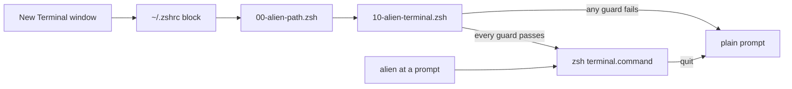

<!--
title: '⚙️ SHELL HOOK & INSTALLER'
description: 'How home/ and scripts/bootstrap.zsh put the cabinet in every new shell: the startup chain, the hook''s guards in order, how each file finds the repository, what the installer writes and the records the door reads, and how to add a file to home/. Read it before changing any of them.'
type: guide
keywords: [zsh, zshrc, symlinks, bootstrap, conf.d, launcher, dotfiles]
-->

<div align="center">

# ⚙️ SHELL HOOK & INSTALLER

<a name="top"></a>

**How a new shell reaches the cabinet, and what the installer changes to make it so.**

_Every guard stands aside toward a plain prompt._

</div>

---

## 💡 From A New Shell To The Cabinet



The installer's block in `~/.zshrc` sources every `*.zsh` file in
`${XDG_CONFIG_HOME:-$HOME/.config}/zsh/conf.d`, in name order, with the glob
qualifier `(N-.)`: the `-` follows a link to judge the file at its far end,
which is what lets a symlinked leaf count at all. `00-alien-path.zsh` puts
`~/.local/bin` on `PATH`, and Homebrew's `bin` when Homebrew is installed but
not on `PATH`, so `alien` is a command before the hook runs.
`10-alien-terminal.zsh` is the hook.

**The hook runs the cabinet with `zsh`, not `exec`**, from inside that loop.
Quitting the cabinet leaves you at the prompt you would have had, in the same
window. It also means that whatever is sourced after the hook, a leaf named
after `10-` or the rest of `~/.zshrc` below the block, runs only once the
cabinet has quit.

---

## 🛡️ The Hook's Guards, In Order

Each guard returns before anything is drawn, so the hook does nothing unless
every one of them passes:

| #   | It stands aside when                             | Read from                                                      |
| :-- | :----------------------------------------------- | :------------------------------------------------------------- |
| 1   | The shell is not interactive                     | `[[ -o interactive ]]`                                         |
| 2   | It is running a command string, as `zsh -c` does | `ZSH_EXECUTION_STRING`                                         |
| 3   | Its input or output is not a terminal            | `[[ -t 0 && -t 1 ]]`                                           |
| 4   | `TERM` is unset or `dumb`                        | `TERM`                                                         |
| 5   | It is inside tmux or screen, or over ssh         | `TMUX`, `STY`, `SSH_TTY`, `SSH_CONNECTION`                     |
| 6   | It is in VS Code's, Warp's or Hyper's terminal   | `TERM_PROGRAM` is `vscode`, `WarpTerminal` or `Hyper`          |
| 7   | It is already inside the suite                   | `ALIEN_DOOR`, which the door exports                           |
| 8   | It was told not to, for this one shell           | `ALIEN_NO_TERMINAL`, or its older name `ALIEN_NO_DOOR`         |
| 9   | The cabinet is opening tabs of its own right now | `dealing` in the state folder, holding an expiry still to come |
| 10  | There is no `terminal.command` where it looked   | `ALIEN_REPO`, or its own resolved path                         |
| 11  | The switch does not read `on`                    | The last `terminal.hook` line of `terminal.conf`               |

**The switch is read by eye and never sourced**, because a file that runs in
every new shell must not hand another file the power to run code. The hook
takes the value after the last `terminal.hook` line, or the older `door.hook`,
lower-cased: anything but `on` leaves a plain prompt, and so does a missing
file or key. The `dealing` flag clears itself by expiring, not by being
deleted, so a cabinet that dies while opening tabs cannot leave every new
shell without a way in.

When every guard passes, the hook exports `ALIEN_DOOR`, `ALIEN_REPO` and
`ALIEN_HOUSE`, then runs `zsh "$root/terminal.command"`.

---

## 📦 How Each File Finds The Repository

Nothing writes the repository's path down at install time. Each file works it
out from its own resolved path, so the links are the only record:

| File                                            | Finds the root by                                                       |
| :---------------------------------------------- | :---------------------------------------------------------------------- |
| `home/.local/bin/alien`                         | `${0:A}`, then four levels up                                           |
| `home/.config/zsh/conf.d/10-alien-terminal.zsh` | `ALIEN_REPO` when set, else `${(%):-%x}`, resolved, then five levels up |
| `terminal.command`                              | `${(%):-%x}`, resolved: the folder it is in                             |
| `scripts/bootstrap.zsh`                         | `${0:A}`, then two levels up                                            |

That is why `home/` keeps exactly its shape: a leaf moved one folder deeper
climbs to the wrong root. It is also why moving the clone fails safe. The
links dangle, the hook finds no `terminal.command` and does nothing, `alien`
says it cannot find the door, and `--install` from the new folder links them
again.

---

## ⚙️ What The Installer Writes

`--install`, and the same steps behind the installer's own question:

- **Three links**, one for each entry in `LEAVES`, from `home/<leaf>` to
  `~/<leaf>`. A link that already points here is kept, a link that points
  anywhere else is replaced, and a real file in the way is moved aside to
  `<leaf>.pre-alien`.
- **One block**, the lines in `ZLINES`, appended to `${ZDOTDIR:-$HOME}/.zshrc`
  between `# >>> ALIEN dotfiles >>>` and `# <<< ALIEN dotfiles <<<`, unless
  the file already holds both marks. Before writing, it copies the file to
  `.zshrc.pre-alien` when no such copy exists yet, so the copy is the file as
  it was before the first install. The step that writes the block and the step
  that removes it read the same `ZLINES`, so they cannot drift apart.
- **Two folders**: `${XDG_STATE_HOME:-$HOME/.local/state}/alien`, and
  `${XDG_CONFIG_HOME:-$HOME/.config}/zsh/conf.d`.
- **The switch**: `terminal.hook = on` in `terminal.conf`, in the clone. The
  writer replaces the first `terminal.hook` line, drops any later one, and
  keeps every other line as it was.

`--remove` takes the block out, unlinks only the links that point back into
this clone, and turns the switch off. It leaves `.zshrc.pre-alien`, the state
folder and Homebrew's tools where they are.

> [!WARNING]
> **The links always go under `~/.config` and `~/.local/bin`.** The block
> sources `$XDG_CONFIG_HOME/zsh/conf.d` when `XDG_CONFIG_HOME` is set, and the
> PATH leaf adds `$XDG_BIN_HOME` when that is set. With either one pointing at
> another folder, the shell looks where the links are not. Leave them unset,
> or point them at the defaults.

---

## 🤖 One Installer, Two Readers

From a prompt, the installer prints a page of text. From the door's
**[N] INSTALL** and **[U] UNINSTALL**, it runs with `ALIEN_REPORT=1`, and every
line its steps report through `ok`, `warn`, `bad` and `note` comes out as a
record, `state<TAB>text`, with the state `ok`, `warn`, `bad` or `info` and no
colour. The door draws those records on the glass itself.

| Flag                 | What it does                                                                                                           |
| :------------------- | :--------------------------------------------------------------------------------------------------------------------- |
| none, `--on install` | Its checks and a question, then the links, the block and the switch, then the tools' own question when any are missing |
| `--on reset`         | Its checks and a question, then the block out, the links gone and the switch off                                       |
| `--install`          | The links, the block and the switch, asking nothing                                                                    |
| `--remove`           | The block out, the links gone and the switch off, asking nothing                                                       |
| `--tools`            | Homebrew if it is missing, `brew bundle` on the Brewfile, then ollama started at login                                 |
| `--plan`             | The lines `--tools` would run, as records, with nothing run                                                            |
| `--report`           | The checks alone, as records                                                                                           |
| `--status`           | The checks, as a page                                                                                                  |
| `--hook on`, `off`   | The switch alone                                                                                                       |

The door runs `--report`, `--install`, `--remove` and `--plan` and reads their
records back. It hands the real terminal to `--tools`, which is interactive
because Homebrew asks for a password. Under `TERMINAL_MOCK` it runs only
`--report`, and says nothing on the machine was touched.

So a change here keeps three promises:

- **A step reports through the four emitters**, never a bare `print`. The door
  shows any other line as plain `info`, which hides whether it was good news.
- **The flags the door calls keep their names**, and so does the file:
  `terminal.command` looks for `scripts/bootstrap.zsh` by that path, and its
  INSTALL row answers `no bootstrap.zsh in this folder` when it is gone.
- **`--plan` prints one `info` record per line it would run**, or one `ok` when
  there is nothing to run: the door asks its second question only when there
  are lines.

---

## 🌿 Adding A File To home/

- [ ] **Put it at the path it takes under `~`.** The installer links
      `home/<leaf>` to `~/<leaf>`, so `home/.config/git/ignore` becomes
      `~/.config/git/ignore`.
- [ ] **Add that path to `LEAVES` in `scripts/bootstrap.zsh`.** Linking,
      unlinking and the checks all read that one array.
- [ ] **Put nothing else under `home/`, not even a README.** The door counts
      every file there, `.DS_Store` aside, and offers INSTALL until each one
      resolves back into the clone. A file `LEAVES` does not name is never
      linked, so the menu would say `3 of 4 linked` for good.
- [ ] **Name a zsh leaf for its place in the order.** The block sources
      `conf.d` in name order and the hook runs the cabinet in the foreground,
      so a leaf whose settings the cabinet should inherit, a `PATH` entry or
      an exported variable, is named before `10-`. One named after it runs
      only once the cabinet has quit. A sourced leaf needs no execute bit; a
      program for `~/.local/bin` does, as `alien` carries in git.
- [ ] **Give a file with no extension its line endings.** `.gitattributes`
      already pins `*.zsh` and `*.command` to LF; a file with no extension
      gets its own `text eol=lf` line, as `home/.local/bin/alien` has, at the
      end of the file where 🔄 Template Sync keeps it.
- [ ] **Keep secrets out of it, and check it is tracked.** The dotfiles rules
      in `.gitignore` hold wherever a file lands, `home/` included, and
      [`test_dotfiles_gitignore.py`](../../.github/scripts/test_dotfiles_gitignore.py)
      fails when a tracked file matches one of them. A file a rule catches by
      mistake gets a negation under that rule, never a `git add -f`.

---

## 🛡️ Changing The Hook Safely

The leaves are links into the clone, so an edit to `home/` is live in the very
next shell. A mistake in the hook, or in the cabinet it opens, is in every new
window at once. Keep a way out at hand before you save:

```zsh
ALIEN_NO_TERMINAL=1 zsh               # a plain prompt in this window, now
zsh scripts/bootstrap.zsh --hook off  # no cabinet in new windows, nothing uninstalled
```

- **A new guard returns 0, before the switch is read**, and is written to
  stand aside whenever it is unsure: the cost of a wrong guess is somebody
  locked out of their own terminal.
- **Never `exec` the cabinet, and never source `terminal.conf`.** The first
  makes quitting and closing the window the same act; the second lets a
  settings file run code in every shell.
- **The variable names are contracts.** The door exports `ALIEN_DOOR`, and
  every shell started inside it, the **[T]** shell among them, finds it there
  and stands aside. The older names `door.hook` and `ALIEN_NO_DOOR` are still
  honoured, so an older install keeps working.
- **Check it before a push**: `zsh -n` on every file you touched, then a new
  window, then `zsh scripts/bootstrap.zsh --status`.
  [Checking A Change](../distribution/Checking-A-Change.md) has the rest.

---

## 🔗 See Also

- [README: Install and Ways Out](../../README.md#-install): every flag, and
  the four ways out of the cabinet
- [New Machine Setup](../introduction/New-Machine-Setup.md): the installer in
  the order a new Mac runs it
- [Machine Footprint](../references/Machine-Footprint.md): every file the
  installer and the machines leave on a Mac
- [Troubleshooting](../operations/Troubleshooting.md): a window that opens no
  cabinet, or one that opens a broken one

---

<div align="center">

**Three links, one block, one switch, and a hook that knows when to stay out of the way.**

[↑ Back to Top](#top)

<br />

Built with ❤️ by the Engineering Team. Distributed under the terms in [LICENSE](../../LICENSE).

</div>
